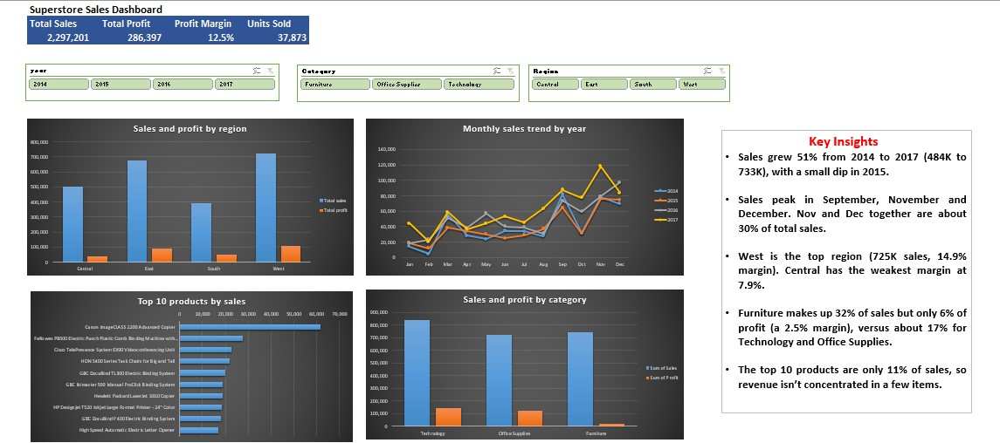

# Superstore Sales Dashboard (Excel)

An interactive Excel dashboard that analyses four years of retail sales (2014-2017) using pivot tables, pivot charts, slicers and KPI cards.

## Dataset
[Superstore Dataset](https://www.kaggle.com/datasets/vivek468/superstore-dataset-final) from Kaggle: 9,994 orders with sales, quantity, discount and profit by region, category and product.

## Tools
- Microsoft Excel (Power Query import, Tables, PivotTables, PivotCharts, Slicers, GETPIVOTDATA)

## What I did
1. Re-imported the CSV with the date columns forced to MDY, because Excel had swapped day and month on many dates.
2. Verified data quality: no ship date earlier than its order date, and all 19,988 date cells were real dates.
3. Converted the data to an Excel Table and added Year, Month No and Month columns.
4. Built pivots for region, monthly trend, top 10 products, category and KPIs.
5. Added Year, Category and Region slicers connected to every pivot, so one click filters the whole dashboard.

## Key insights
- Sales grew 51% from 2014 to 2017 (484K to 733K), with a small dip in 2015.
- Sales peak in September, November and December. November and December together are about 30% of total sales.
- West is the top region (725K sales, 14.9% margin). Central has the weakest margin at 7.9%.
- Furniture makes up 32% of sales but only 6% of profit (a 2.5% margin), versus about 17% for Technology and Office Supplies.
- The top 10 products are only 11% of sales, so revenue isn't concentrated in a few items.

## Files
- `superstore_sales_dashboard.xlsx`: the full workbook (open the Dashboard sheet)
- `superstore1_dashboard.jpg`: screenshot of the dashboard

## Overall results
Total sales: 2,297,201 | Total profit: 286,397 | Profit margin: 12.5% | Units sold: 37,873
